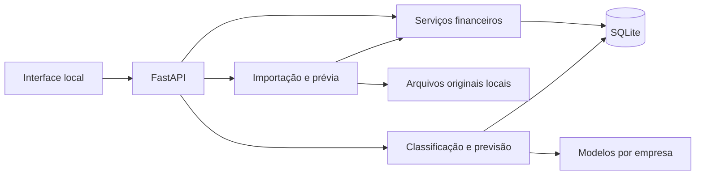

# Arquitetura operacional da versão 1.1

## Estrutura

```text
run.py                  inicialização local e abertura do navegador
looniemind/
  api.py                API, contratos de entrada, erros e interface estática
  db.py                 esquema SQLite, conexões, versão e auditoria
  domain.py             dinheiro, datas, tipos e normalização de texto
  imports.py            leitura CSV/XLS/XLSX, prévia e confirmação
  services.py           empresas, lançamentos, revisão, consultas, exportação e backup
  models.py             TF-IDF/LightGBM, regras e previsão temporal
  synthetic.py          geração reproduzível das bases rotulada e financeira
  workbooks.py          modelos de importação e relatórios analíticos
  backup.py             restauração validada em pasta nova
web/                    interface nativa e SVG, sem build ou dependências remotas
scripts/                treinamento, demonstração e restauração por linha de comando
tests/                  testes de domínio, API, importação, modelos e recuperação
data/                   gerado na execução; ignorado pelo Git
```



Um processo Uvicorn atende a interface e a API na mesma origem. O navegador não acessa o banco diretamente. Operações de cálculo/arquivos usam os serviços Python. Chamadas síncronas da API são executadas pelo pool de threads do servidor; uploads encaminham a leitura/normalização para esse pool. Treinamento é explícito, limitado a dois threads do LightGBM, sem fila externa.

## Dados e versão do esquema

O esquema v2 é criado de forma idempotente em `looniemind/db.py`, registrado em `schema_migrations` e em `PRAGMA user_version=2`. Bancos v1 recebem os campos documento, contraparte, centro_custo, conta, forma_pagamento, competencia, observacoes e id_externo, com cópia prévia em `data/backups/antes-da-versao-2.sqlite3`. O arquivo vazio original não é reutilizado nem modificado. A restauração aceita backups v1 e v2 e migra para v2 em pasta nova.

| Tabela | Campos e função |
|---|---|
| Empresas | Nome, descrição, saldo inicial em centavos, data de referência, indicador de demonstração, revisão e timestamps. |
| Categorias | Nome e tipo por empresa; unicidade por empresa/nome/tipo. |
| Planilhas | UUID, empresa, nome original, caminho interno, SHA-256, aba, opções de normalização, estado, contagens e timestamps. |
| Lancamentos | Empresa, planilha/linha de origem quando importado, descrição, categoria textual, valor em centavos, data, tipo, revisão, origem, sugestão, dados originais e timestamps. |
| Auditoria | Empresa, ação, entidade, referência, detalhes estruturados e data UTC. |
| schema_migrations | Versões aplicadas e data de aplicação. |

Chaves estrangeiras são habilitadas em toda conexão. Índices atendem consultas por empresa/data e vínculo de importação. Transações de escrita usam `BEGIN IMMEDIATE`, com rollback em falhas. Categorias continuam textuais como no acordo original; códigos das classes pertencem ao modelo e não são gravados misturados com nomes.

As datas das movimentações são datas civis ISO; timestamps de auditoria usam UTC. O relógio/data local da máquina define o dia atual. A v1 usa BRL e uma conta consolidada por empresa. Não implementa competência, parcelas ou vencimentos futuros.

## Regras financeiras

- `valor_centavos` é inteiro estritamente positivo, até 100.000.000.000.000 centavos por lançamento. Tipo 1 = receita; tipo 2 = despesa; `NULL` = pendente sem definição.
- Normalização monetária usa `Decimal`, com `ROUND_HALF_UP` para frações de centavo. Cálculos de saldos/totais usam inteiros. A interface envia centavos, não valores em ponto flutuante.
- Saldo atual = saldo inicial + receitas − despesas realizadas entre a data de referência, inclusive, e hoje. O filtro do dashboard não altera essa referência.
- O resultado do período é receitas − despesas daquele período. Movimentações sem tipo são excluídas dos totais e sinalizadas; valores conhecidos sem categoria continuam compondo o caixa, mas aguardam revisão.
- Não se deduz receita de qualquer valor positivo. Um extrato assinado exige confirmação na importação; negativos indicam despesa e conflitos com tipo Receita são rejeitados.
- Dias de cobertura = saldo positivo dividido pela média de saídas dos últimos 30 dias. Sem saídas, o indicador não é calculado. Variações percentuais não são calculadas sobre denominador zero.
- Revisões humanas são preservadas. Edições/exclusões/importações incrementam a revisão da empresa, invalidando a previsão em cache.

## Importação

Upload limitado a 10 MB, 10.000 linhas, 100 colunas e 30 abas. XLSX também tem limite de 100 MB de conteúdo descompactado e 2.000 entradas ZIP. CSV aceita UTF-8/BOM e CP1252, com vírgula, ponto e vírgula, tabulação ou barra vertical como separador. Cabeçalhos podem estar nas primeiras 21 linhas. Leitores não executam macros nem fórmulas.

O arquivo é armazenado sob UUID interno, nunca sob um caminho fornecido pelo usuário. A prévia mantém as opções no banco e não grava lançamentos. Na confirmação, o arquivo é lido/validado novamente usando as opções armazenadas. O usuário precisa atualizar a prévia após mudar opções na tela.

Índice parcial impede duas importações confirmadas da mesma empresa/arquivo/aba. A confirmação da mesma importação é idempotente. Linhas semelhantes às existentes exigem concordância; não são eliminadas automaticamente. Linhas iguais dentro de um arquivo são preservadas. Importação parcial exige consentimento explícito e registra a quantidade rejeitada. O original permite identificar essas linhas novamente pela prévia/leitura do arquivo.

Desfazer remove todos os lançamentos vinculados e registra a ação; o arquivo original e a importação desfeita permanecem. Prévia abandonada pode ser retomada no histórico; a v1 não realiza limpeza automática desses arquivos.

## Aprendizado de máquina

### Classificação

Alvo supervisionado: combinação `tipo|categoria`. FeatureUnion de TF-IDF de palavras/bigramas (até 12.000 atributos) e caracteres dentro de palavras, n-gramas 3–5 (até 16.000 atributos), seguido de LightGBM Classifier (90 estimadores, 15 folhas, profundidade máxima 5, mínimo 5 exemplos por folha, taxa 0,1 e seed 42). Classes numéricas são codificadas/decodificadas dentro do artefato. Apenas a descrição entra no modelo.

O treino exige duas classes, pelo menos 24 exemplos e quatro grupos de descrição por classe. Há treino, validação e teste por famílias disjuntas, com arredondamento por classe e proporções efetivas registradas. A base v2 tem 14.400 exemplos/288 famílias: 9.600/192 no treino e 2.400/48 em cada uma das outras partições. Descrições normalizadas com dígitos substituídos ficam juntas quando não há grupo explícito. O CLI preserva os campos grupo e fonte do CSV rotulado. TF-IDF é ajustado apenas no treino durante a avaliação; depois, o artefato de uso é reajustado sobre a base completa. Resultados sintéticos não comprovam qualidade em dados reais.

Artefatos `classifier-<empresa>.joblib` e JSON de metadados ficam em `data/models/`. Incluem representador, classes, modelo, origem, métrica, hash de versão e dependências. Arquivos enviados pelo usuário nunca são carregados como pickle/joblib. O backup não copia modelos, e a restauração pede novo treino.

Sugestões são filtradas pelo tipo já conhecido. Texto sem nenhum termo reconhecido não recebe sugestão do modelo. Sem artefato válido, 12 regras simples por palavra-chave podem sugerir categorias sem inventar score. Não há calibração de probabilidade nem aplicação automática por limiar.

Treino por CLI:

```powershell
.\.venv\Scripts\python.exe -m scripts.train_models --company 1 --source reviewed
.\.venv\Scripts\python.exe -m scripts.train_models --company 1 --csv "base-rotulada.csv"
```

O CSV de treinamento usa UTF-8 e `descricao;tipo;categoria`. A empresa deve existir. A origem externa é identificada nos metadados. Para gerar a demonstração por CLI: `python -m scripts.create_demo`.

### Previsão

Séries diárias separadas de receitas/despesas, limitadas aos últimos 1.095 dias na preparação de variáveis. O cálculo do saldo mantém todas as movimentações posteriores à referência. Datas futuras são recusadas na entrada.

Com 28 dias de histórico recente: referência sazonal de 7 dias. A partir de 90 dias e 20 dias com valores positivos por série: LightGBM Regressor (65 estimadores, 10 folhas, profundidade 4, mínimo 7 exemplos por folha, taxa 0,07, seed 42). Variáveis: dia da semana, dia/mês, componente semanal, lags 1/7/14/28 e médias anteriores de 7/28 dias.

O teste reserva 14–21 dias finais e produz previsões recursivas, sem usar valores reais futuros para formar lags. Compara MAE do modelo e da referência e escolhe o melhor por série. WAPE é registrado quando seu denominador não é zero. O modelo escolhido é reajustado no histórico disponível. Receitas/despesas previstas negativas são limitadas a zero e convertidas para centavos inteiros.

A API informa método, avaliação, origem, quantidade de dias, sinalização de demonstração e motivo da indisponibilidade. Não há intervalo de confiança anunciado. Histórico com última movimentação há mais de 7 dias não gera projeção; lacunas dentro da série são assumidas como zero e essa premissa aparece na tela.

## API e interface

O contrato OpenAPI completo é gerado em `/api/openapi.json`; `/api/docs` renderiza referência local sem CDN. Prefixo das operações por empresa: `/api/companies/{company_id}`.

| Operação | Caminho / método |
|---|---|
| Listar/criar empresas | GET/POST `/api/companies` |
| Atualizar empresa | PUT no recurso da empresa |
| Indicadores | GET `/summary?periodo=month|30d|90d|year|all` |
| Listar/criar/editar/excluir lançamentos | GET/POST `/transactions`; PUT/DELETE `/transactions/{id}` |
| Filtros/paginação | `inicio`, `fim`, `tipo`, `categoria`, `busca`, `pendentes`, `pagina`, `por_pagina` |
| Receber arquivo | POST `/imports`, multipart `arquivo` e JSON textual `opcoes` |
| Revalidar/confirmar/desfazer importação | POST `/imports/{id}/preview`, `/confirm`, `/undo` |
| Categorias | GET/POST `/categories` |
| Modelo e treinamento | GET `/model`; POST `/model/train` |
| Sugerir/aceitar classificações | POST `/classify`; POST `/classify/accept`, corpo `{ids:[...]}` |
| Previsão | GET `/forecast?dias=7|30|60|90` |
| Exportar | GET `/export?formato=csv|xlsx`; GET `/forecast/export` |
| Auditoria | GET `/audit`, últimas 100 ações |
| Modelo de arquivo / backup | GET `/api/template`; GET `/api/backup` |

Filtros são parametrizados em SQL. Erros devolvem `mensagem` e, quando aplicável, `detalhes`. Falhas inesperadas retornam mensagem genérica sem revelar dados financeiros. Na UI, todo texto importado é escapado antes de montar HTML. Exportações tratam textos com prefixos de fórmula.

## Operação e limites

Servidor ligado a `127.0.0.1`; Host restrito a localhost/127.0.0.1 e host de testes. Escritas com Origin diferente são recusadas. Não há autenticação/controle entre operadores: o isolamento por empresa é funcional para um operador local, não autorização de um produto multiusuário.

Configuração de armazenamento: variável `LOONIEMIND_DATA_DIR`, padrão `data/`. Banco, originais e modelos não são versionados. O backup faz snapshot consistente do SQLite e inclui originais referenciados. A restauração só aceita pasta nova, aplica o esquema interno confiável e copia dados; não executa SQL do arquivo recebido. Versões futuras devem preservar migrações e testes de recuperação.

Testes de CI foram configurados para Windows/Linux com Python 3.12; a sessão de entrega valida o Windows local. Não há hospedagem pública, atualizações automáticas, instalador nativo ou serviços financeiros reais. Métricas de ML são evidência interna, não validação externa.
